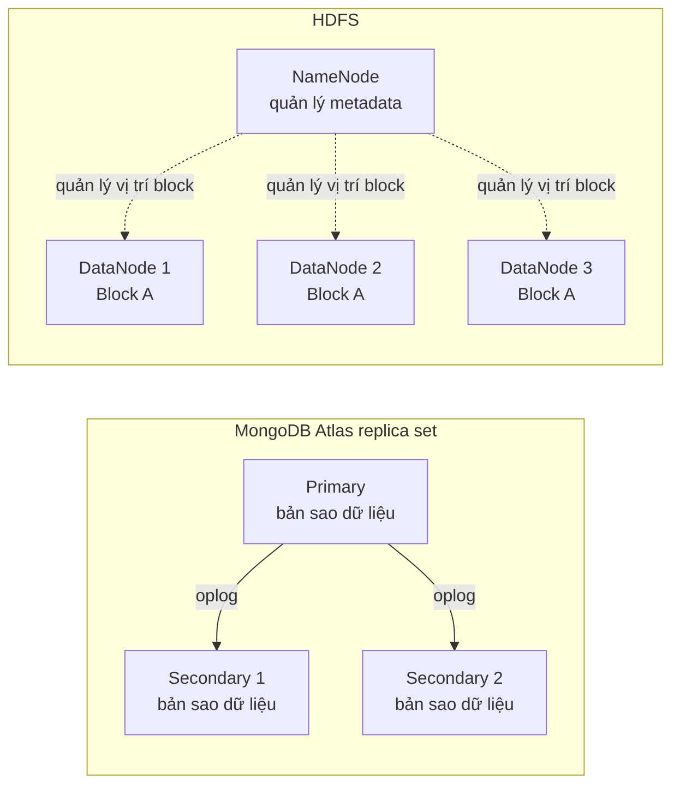

# Notes API — Bài 3: NoSQL và lưu trữ đối tượng

API Express 5 sử dụng MongoDB Atlas để lưu ghi chú và Supabase Storage để lưu tệp đính kèm. Endpoint hệ thống `GET /` của Bài 1 được giữ nguyên.

## 1. Cài đặt

Yêu cầu Node.js 22 trở lên

```bash
npm install
cp .env.example .env
```

Lệnh `npm install` cài các dependency mới và đồng bộ lại `package-lock.json` với `package.json`

## 2. Cấu hình dịch vụ đám mây

### MongoDB Atlas

1. Tạo project `cloud-lab` và cluster theo cấu hình của bài thực hành, chọn AWS và Singapore nếu tùy chọn này khả dụng
2. Tạo database user `notes_app`, cấp quyền `readWrite` trên database `notes`
3. Thêm IP Codespaces/Vercel vào Network Access. Quy tắc `0.0.0.0/0` cho phép kết nối từ mọi IPv4 nên chỉ dùng tạm cho lab; môi trường thật cần giới hạn IP hoặc dùng cơ chế mạng phù hợp
4. Lấy connection string từ Connect → Drivers → Node.js, thay password và thêm tên database `notes` trước dấu `?`

### Supabase Storage

1. Tạo project và bucket `attachments`
2. Bật Public bucket để URL trong bài thực hành có thể mở trực tiếp trên trình duyệt
3. Lấy Project URL và secret API key ở Project Settings → API Keys. Nếu project cũ chỉ hiển thị `service_role`, có thể dùng khóa này cho bài lab
4. Điền URL và khóa vào `.env`

**Lưu ý bảo mật:** secret/service-role key chỉ được dùng ở máy chủ, tuyệt đối không đưa vào frontend hoặc commit lên GitHub. Bucket public cho phép người có URL đọc tệp; không dùng cách này cho hồ sơ hoặc dữ liệu nhạy cảm. Khi cần tệp riêng tư, chuyển bucket sang Private và cấp signed URL có thời hạn

Mẫu `.env`:

```dotenv
MONGODB_URI=mongodb+srv://notes_app:<password>@<cluster>.mongodb.net/notes?retryWrites=true&w=majority
SUPABASE_URL=https://<project-ref>.supabase.co
SUPABASE_SERVICE_KEY=<secret-api-key-or-legacy-service-role>
PORT=3000
```

Tệp `.env` đã được thêm vào `.gitignore`; không commit thông tin xác thực thật

## 3. Chạy API

```bash
npm start
```

Máy chủ chỉ bắt đầu lắng nghe sau khi kết nối MongoDB thành công

### Các endpoint

| Phương thức | Đường dẫn | Chức năng |
| --- | --- | --- |
| GET | `/` | Thông tin máy chủ, giữ từ Bài 1 |
| GET | `/notes` | Liệt kê tối đa 50 ghi chú mới nhất |
| GET | `/notes?tag=nosql` | Lọc ghi chú theo tag |
| GET | `/notes/:id` | Lấy một ghi chú |
| POST | `/notes` | Tạo ghi chú, trả HTTP 201 |
| PUT | `/notes/:id` | Cập nhật ghi chú |
| DELETE | `/notes/:id` | Xóa ghi chú, trả HTTP 204 |
| POST | `/notes/:id/attachment` | Tải tệp lên Supabase Storage, trường multipart là `file` |

Các lỗi dữ liệu đầu vào, ObjectId không hợp lệ và tệp vượt giới hạn 2 MB được trả HTTP 400; không tìm thấy ghi chú trả HTTP 404

### Thử CRUD và tải tệp

Tạo ghi chú:

```bash
curl -i -X POST http://localhost:3000/notes \
  -H "Content-Type: application/json" \
  -d '{"title":"Ôn chương 3","content":"HDFS vs GFS","tags":["cloud","nosql"]}'
```

Lấy danh sách và lọc theo tag:

```bash
curl -i "http://localhost:3000/notes"
curl -i "http://localhost:3000/notes?tag=nosql"
```

Thay `<id>` bằng `_id` nhận được từ API:

```bash
curl -i http://localhost:3000/notes/<id>
curl -i -X PUT http://localhost:3000/notes/<id> \
  -H "Content-Type: application/json" \
  -d '{"title":"Ôn chương 3 - cập nhật","content":"MongoDB Atlas và HDFS","tags":["cloud","nosql"]}'
curl -i -X DELETE http://localhost:3000/notes/<id>
```

Tải tệp lên một ghi chú còn tồn tại:

```bash
echo "Tệp thử" > note.txt
curl -i -X POST http://localhost:3000/notes/<id>/attachment \
  -F "file=@note.txt"
```

Mở trường `attachmentUrl` trong phản hồi để kiểm tra tệp

## 4. Đo hiệu quả chỉ mục

Schema định nghĩa chỉ mục đa khóa `{ tags: 1 }`. Chạy:

```bash
node scripts/seed.js
node scripts/explain.js
```

Hoặc dùng script npm:

```bash
npm run seed
npm run explain
```

Script seed tạo 2.000 tài liệu có `owner: "seed"`. Script explain so sánh truy vấn `tags: "docker"` khi ép quét tự nhiên bằng `hint({ $natural: 1 })` với truy vấn sử dụng chỉ mục. Kết quả ghi:

- `docsExamined`: số tài liệu được kiểm tra
- `returned`: số tài liệu trả về
- `ms`: thời gian thực thi do MongoDB báo cáo
- Tỉ số giảm: `docsExamined(quét toàn bộ) / docsExamined(có chỉ mục)`

Ghi số liệu thực tế vào báo cáo sau khi chạy trên cluster của bạn; không lấy số minh họa làm số đo. Hai truy vấn phải trả về cùng số tài liệu thì phép so sánh mới hợp lệ

## 5. Quan sát nhân bản và liên hệ HDFS

Trong Atlas, mở cluster → Overview/Metrics, xác minh số member, vai trò Primary/Secondary và chụp ảnh làm minh chứng. Sơ đồ khái niệm:



MongoDB replica set sao chép tập dữ liệu của replica set giữa các member; Primary ghi thay đổi vào oplog và Secondary áp dụng các thay đổi đó. HDFS chia tệp thành block và nhân bản từng block trên các DataNode; NameNode quản lý metadata và vị trí block, không phải nơi chứa bản sao dữ liệu

## 6. Trả lời câu hỏi phản biện

1. **Nếu có 2 triệu tài liệu:** quét toàn bộ có thể phải kiểm tra đến 2.000.000 tài liệu cho một truy vấn. Với chỉ mục, số tài liệu cần kiểm tra phụ thuộc độ chọn lọc của tag và chỉ mục; có thể ước lượng bằng tỉ số đo được ở quy mô 2.000 tài liệu, nhưng đây chỉ là ngoại suy khi phân bố dữ liệu tương tự. Giới hạn 100 thao tác/giây trong đề bài là giới hạn số thao tác, không phải giới hạn số tài liệu được quét; chỉ mục giảm công việc cho từng truy vấn, không tự làm tăng quota thao tác/giây
2. **Lưu tệp trên object storage, lưu URL trong MongoDB:** tệp nhị phân được tách khỏi tài liệu nghiệp vụ, tránh làm phình document, giảm dữ liệu phải đọc/ghi khi truy vấn ghi chú và tận dụng dịch vụ chuyên phục vụ tệp. MongoDB giới hạn mỗi BSON document ở 16 MiB; URL/metadata nhỏ hơn nhiều so với nội dung file. Supabase Storage lưu object và cung cấp API/URL để phục vụ file
3. **Ý nghĩa của hệ số 3:** cả hai đều hướng đến tính sẵn sàng và khả năng chịu lỗi khi một máy/nút hoặc bản sao gặp sự cố. Khác biệt là MongoDB nhân bản tập dữ liệu của replica set giữa các member database (một Primary, các Secondary); HDFS nhân bản từng block của tệp lên các DataNode, với NameNode theo dõi metadata và vị trí block. Đây là hai cấp nhân bản khác nhau, không thể coi một node Atlas tương đương một block HDFS

## Tài liệu kỹ thuật

- [MongoDB Replication](https://www.mongodb.com/docs/manual/replication/)
- [MongoDB BSON Document Size](https://www.mongodb.com/docs/manual/core/document/)
- [Supabase Storage](https://supabase.com/docs/guides/storage)
- [Apache HDFS Design](https://hadoop.apache.org/docs/stable/hadoop-project-dist/hadoop-hdfs/HdfsDesign.html)


## 7. Kết quả thực nghiệm và tài liệu nộp Bài 3

Số liệu `npm run explain` do người thực hiện cung cấp:

| Phương pháp | docsExamined | returned | ms |
| --- | ---: | ---: | ---: |
| Quét toàn bộ | 2.000 | 571 | 1 |
| Dùng chỉ mục | 571 | 571 | 1 |

Chỉ mục giảm `docsExamined` 3,50 lần, tương đương 71,45%. Hai truy vấn cùng trả về 571 tài liệu; thời gian hiển thị đều là 1 ms.

Kết quả quan sát replica set: `hello` trả về 3 thành viên trong `hosts`, có một thành viên được xác định là Primary.

Tài liệu nộp:
- [Kết quả thực nghiệm và trả lời phản biện](docs/Bai3/ket-qua-thuc-nghiem.md)
- [Sơ đồ so sánh Atlas – HDFS](docs/Bai3/so-do-atlas-hdfs.md)
- [Ảnh trình bày lại kết quả explain.js](docs/Bai3/explain-output.svg)

**Lưu ý về ảnh:** SVG là bản trình bày lại từ log terminal do người thực hiện cung cấp, không phải ảnh chụp trực tiếp Codespaces. Nếu yêu cầu chấm bài cần ảnh chụp gốc, hãy bổ sung ảnh chụp màn hình terminal.
