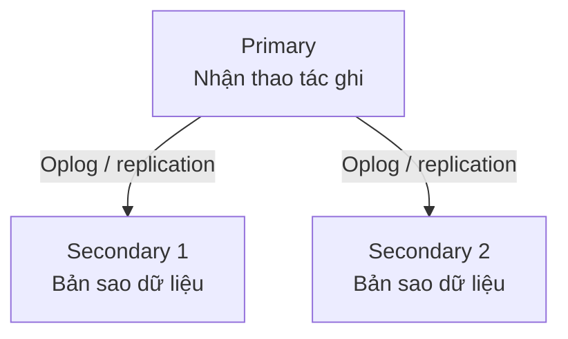
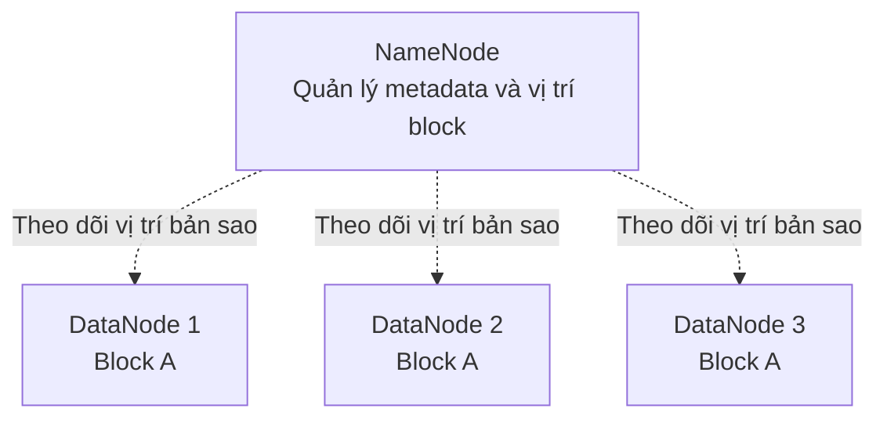

# Sơ đồ so sánh nhân bản MongoDB Atlas và HDFS

## MongoDB Atlas – Replica Set

## HDFS – Replication Factor = 3

| Tiêu chí | MongoDB Atlas | HDFS |
|---|---|---|
| Cơ chế | Replica Set | Block replication |
| Đơn vị nhân bản | Dữ liệu replica set giữa các thành viên database | Từng block của tệp trên các DataNode |
| Điều phối | Primary nhận ghi; Secondary đồng bộ | NameNode quản lý metadata/vị trí; DataNode lưu block |
| Mục tiêu | Tính sẵn sàng và chịu lỗi | Độ tin cậy và chịu lỗi khi lưu tệp phân tán |

Sơ đồ mô tả nguyên lý logic, không khẳng định vị trí vật lý hoặc failure domain thực tế.
