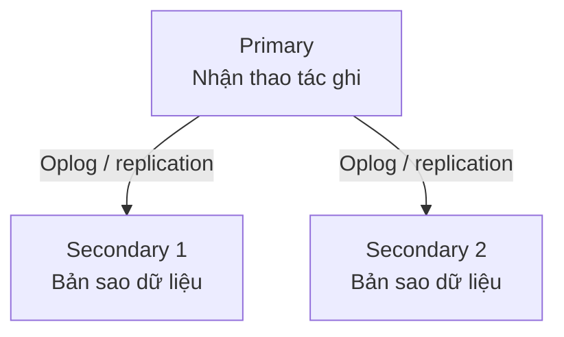
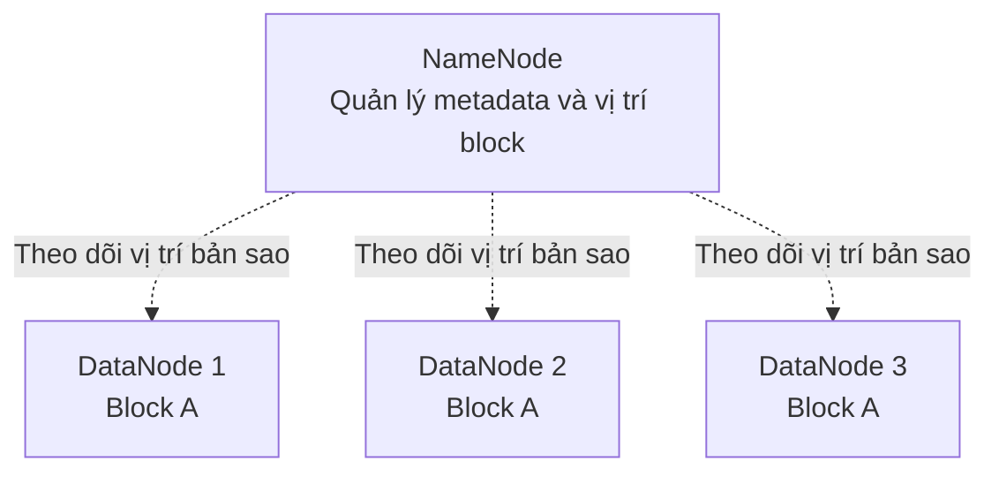

# Sơ đồ so sánh nhân bản MongoDB Atlas và HDFS

## MongoDB Atlas – Replica Set

## HDFS – Replication Factor = 3

## So sánh

| Tiêu chí | MongoDB Atlas | HDFS |
|---|---|---|
| Cơ chế | Replica Set | Block replication |
| Số lượng trong bài thực hành | 3 thành viên replica set | Hệ số nhân bản mặc định 3 bản cho mỗi block |
| Đơn vị nhân bản | Dữ liệu của replica set được đồng bộ giữa các thành viên | Từng block của tệp được lưu thành nhiều bản trên DataNode |
| Vai trò điều phối | Primary nhận ghi; Secondary đồng bộ dữ liệu | NameNode quản lý metadata và vị trí block; DataNode lưu block |
| Mục tiêu | Tăng tính sẵn sàng và khả năng chịu lỗi | Tăng độ tin cậy và khả năng chịu lỗi khi lưu tệp phân tán |

**Kết quả quan sát trên cluster của bài thực hành:** lệnh `hello` trả về một replica set có 3 địa chỉ thành viên; trường `primary` xác định một thành viên đang giữ vai trò Primary. Hai địa chỉ còn lại là các thành viên còn lại của replica set. Sơ đồ trên mô tả nguyên lý, không khẳng định vị trí vật lý hoặc failure domain của các nút.
