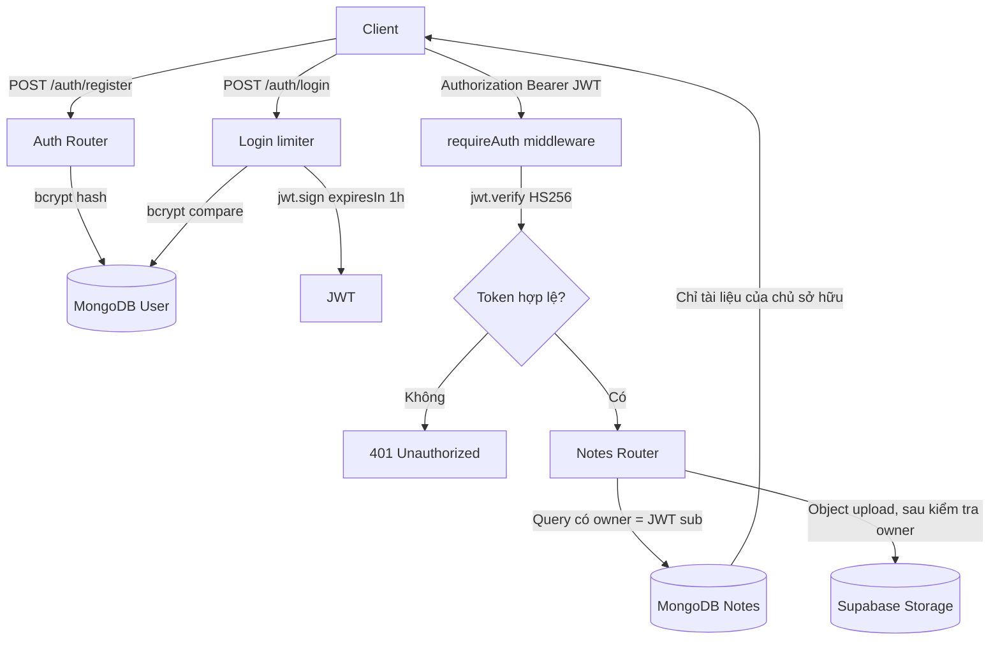

# Luồng xác thực và phân quyền

JWT xác định người dùng qua claim `sub`. Mọi truy vấn ghi chú trong API đều lọc thêm `owner: req.user.sub`; tài nguyên không thuộc người dùng được trả 404 để tránh tiết lộ sự tồn tại.
